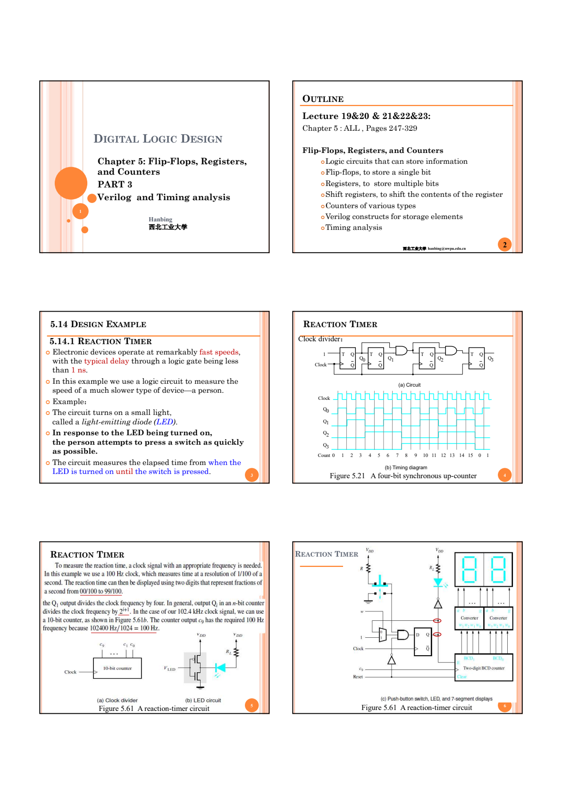
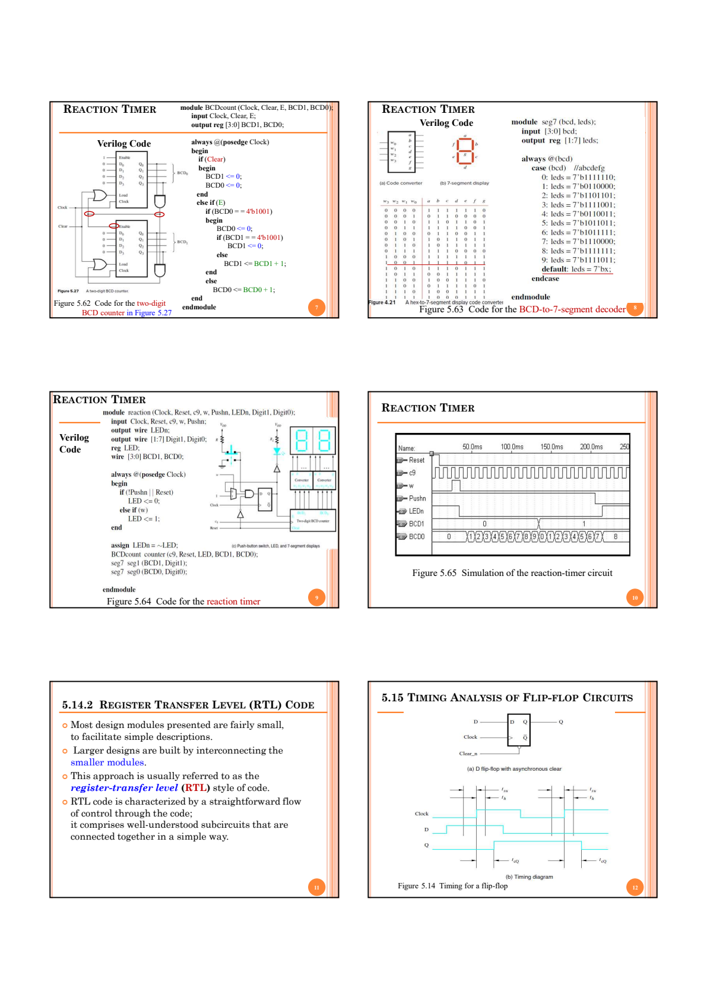
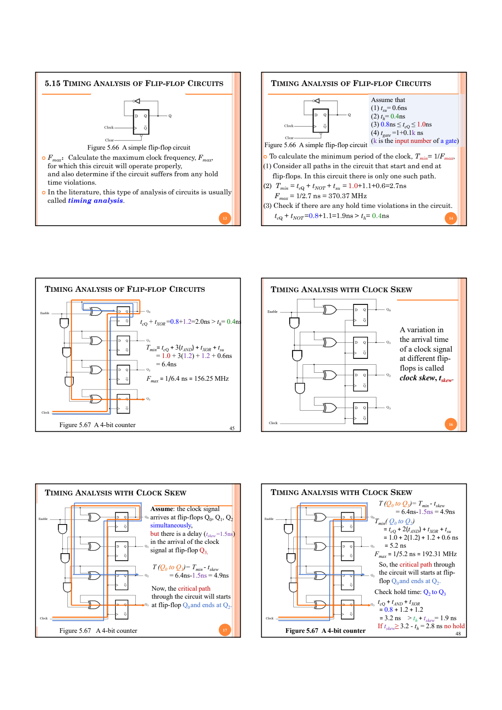
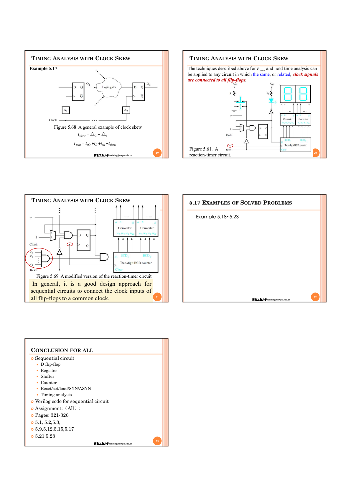

# 数字逻辑设计

## 时序电路：Verilog、反应时间计时器与时序分析

> 根据 Lecture 19–23 的 Chapter 5 Part 3 整理。原笔记《数字逻辑设计.md》保持不变。
> 本 PDF 实际包含 4 页，每页排版多张幻灯片，共 23 张。以下“幻灯片”指画面右下角编号。
> 延续原笔记的标题、英文术语、中文解释、公式、表格和图示格式；标为“基础补充”的内容用于衔接学习，不表示 PDF 对这些内容作了完整讲解。

### 学习顺序

1. 先理解触发器如何在时钟边沿保存数据。
2. 看懂 `always`、`<=`、复位、使能，再看寄存器和计数器。
3. 理解“分频 → 计数 → 显示”的反应计时器。
4. 最后学习时序分析：数据既不能来得太晚，也不能来得太早。

### flip-flop 与 Verilog 的联系（基础补充）

#### D flip-flop：保存一位数据

- D：要写入的数据；Q：已经保存的数据；Clock：决定何时更新。
- 对上升沿触发的 D 触发器，在上升沿采样 D，经过传播延迟后 Q 更新。
- 两个上升沿之间，D 即使变化，Q 也不会跟着变化。
- $Q^+$ 表示下一状态，Q 表示当前状态；D 触发器的特征方程为 $Q^+=D$。

```verilog
always @(posedge Clock)
    Q <= D;
```

- `posedge Clock`：Clock 从 0 变成 1 时执行该过程。
- `negedge Clock`：Clock 从 1 变成 0 时执行。
- 这里描述的是硬件的时钟控制关系，不是让程序一直主动查询时钟。

#### blocking / nonblocking assignment（阻塞 / 非阻塞赋值）

> 通常术语写作“阻塞”，而不是“阻滞”。

|写法|名称|理解方式|常见使用场景|
|---|---|---|---|
|`a = b;`|blocking assignment，阻塞赋值|执行到这里时更新 a，后续语句能读到这个新值|组合逻辑过程|
|`a <= b;`|nonblocking assignment，非阻塞赋值|执行语句时计算右侧，左侧更新安排到当前仿真时刻后续的非阻塞更新阶段|时钟触发的时序逻辑过程|

```verilog
always @(posedge Clock) begin
    q1 <= D;
    q2 <= q1;
end
```

假设边沿前 `D=1, q1=0, q2=0`：

1. `q1 <= D` 取得 D 的旧值 1。
2. `q2 <= q1` 取得 q1 的旧值 0。
3. 本次更新后 `q1=1, q2=0`。
4. 下一次上升沿，q2 才能接收到前一次存入 q1 的 1。

- 这对应两个串联的触发器：每个边沿，数据前进一级。
- 若改成同一过程中的 `q1 = D; q2 = q1;`，第二句会读到第一句刚更新的 q1，仿真行为便不同。
- **非阻塞赋值不表示“等下一个时钟才赋值”**：更新仍发生在这次边沿对应的同一仿真时刻，只是属于后续调度阶段。
- 仿真的调度阶段与真实器件的 $t_{cQ}$ 传播延迟不是同一个概念；普通 RTL 中的 `<=` 不会自动精确模拟器件延迟。
- `if (a <= b)` 中的 `<=` 是“小于等于”比较；`a <= b;` 才是非阻塞赋值。

#### reg / wire / assign

- 传统 Verilog 中，`reg` 可在 `always` 等过程内赋值，`wire` 常用于模块连接或连续赋值。
- **`reg` 这个类型名不保证综合出寄存器**；具体硬件取决于过程的触发条件以及赋值是否完整。
- `assign y = ~a;` 是连续赋值，表示一条组合逻辑关系：a 变，y 随之经过逻辑延迟变化。
- `always @(*)` 常用于组合逻辑，输出应在所有分支获得赋值，防止意外推导出锁存器。
- `always @(posedge Clock)` 常用于时序逻辑；某分支不赋值通常表示原值保持。

### register（寄存器，基础补充）

#### 定义

- 一个触发器存 1 bit；多个共享时钟的触发器组成寄存器，保存多位数据。
- `reg [3:0] Q;` 表示一个 4 位过程变量，位编号为 3、2、1、0。
- 若它在边沿触发的过程内更新，通常对应 4 个触发器。

#### clear / load / enable

```verilog
module reg4 (
    input Clock, Clear, Load,
    input [3:0] D,
    output reg [3:0] Q
);
    always @(posedge Clock) begin
        if (Clear)
            Q <= 4'b0000;
        else if (Load)
            Q <= D;
    end
endmodule
```

|上升沿时的条件|下一状态|含义|
|---|---|---|
|Clear=1|0000|清零|
|Clear=0，Load=1|D|并行装载|
|Clear=0，Load=0|Q|保持|

- `if ... else if ...` 决定优先级：本例 Clear 高于 Load。
- Clear 只在上升沿检查，因此是**同步清零**。
- 若写成 `always @(posedge Clock or negedge Clear_n)`，并在过程里先判断 `if (!Clear_n)`，则是低电平有效的**异步清零**。
- 有效电平与同步/异步是两件事：`_n` 表示低电平有效，不单独决定是否异步。

#### shift register（移位寄存器）

```verilog
always @(posedge Clock) begin
    if (Clear)
        Q <= 4'b0000;
    else if (E)
        Q <= {Q[2:0], serial_in};
end
```

- `{...}` 表示位拼接；原 Q 的低三位移动到高三位，串行输入进入最低位。
- 若原来 `Q=4'b1010`，输入为 1，则下一状态为 `4'b0101`。
- 所有右侧位都来自边沿前的旧 Q，不会在一个边沿里连续移很多次。

### counter（计数器，基础补充）

#### binary counter（二进制计数器）

```verilog
always @(posedge Clock) begin
    if (Clear)
        Q <= 4'b0000;
    else if (E)
        Q <= Q + 4'b0001;
end
```

- E=1 时每次上升沿加 1；E=0 时保持。
- 4 位无符号计数器按 `0 → 1 → ... → 15 → 0` 循环，称模 16 计数器。
- `1111 + 0001` 的完整结果为 `10000`，存进 4 位 Q 后只保留低四位 `0000`。

#### synchronous counter（同步计数器）

- 同步计数器各触发器接同一个时钟。
- “同步”不表示所有 Q 在物理上完全同时变化；实际仍有传播延迟。
- 用 T 触发器构成向上计数器时，T=0 保持，T=1 翻转。

|位|无使能时的翻转条件|原因|
|---|---|---|
|Q0|$T_0=1$|每拍翻转|
|Q1|$T_1=Q_0$|低一位全为 1 才进位|
|Q2|$T_2=Q_0Q_1$|低两位全为 1 才进位|
|Q3|$T_3=Q_0Q_1Q_2$|低三位全为 1 才进位|

- 有计数使能 E 时，上述每个条件再与 E 相与。
- 若用 D 触发器实现，翻转关系写为 $D_i=Q_i\oplus T_i$。
- 这解释了后面时序分析电路中的 AND 门链和 XOR 门。

### reaction timer（反应时间计时器）

#### 功能与组成（幻灯片 3–6）

- LED 亮起后，人尽快按按钮。
- 电路记录从 LED 亮起到按键停止之间的时间。
- 数据通路可以理解为：

```text
102.4 kHz 时钟 → 10 位二进制计数器 → c9：100 Hz
                                            ↓
开始/停止控制 → 计数使能 E → 两位 BCD 计数器 → 两个七段译码器 → 数码管
```

- 控制部分决定“是否计时”；计数器保存“已经经过多少个时间单位”。
- 这不是直接测量连续时间，而是通过累计固定周期的时钟来估计时间。



#### clock divider（时钟分频器）

- 二进制计数器最低位每两个输入周期完成一个完整周期，频率为输入的一半。
- 若最低位编号为 0，则第 i 位输出频率为：

$$
f_{Q_i}=\frac{f_{Clock}}{2^{i+1}}
$$

- 例如 Q0 为 2 分频，Q1 为 4 分频，Q9 为 1024 分频。
- 讲义使用 10 位计数器的 c9 输出：

$$
f_{c9}=\frac{102400\text{ Hz}}{2^{10}}=100\text{ Hz}
$$

$$
T_{c9}=\frac{1}{100\text{ Hz}}=0.01\text{ s}=10\text{ ms}
$$

- 注意：“一次翻转”只相当于半个输出周期，不能把翻转次数当成完整周期数。
- 计数器每遇到一个 c9 上升沿加 1，所以显示 N 对应约 $N\times0.01$ 秒。
- 例如显示 27，表示约 0.27 秒；两位可表示 00 到 99，即 0.00 到 0.99 秒。
- 分辨率为 10 ms，不等于绝对测量误差一定为 10 ms；开始/停止与计数边沿的相位也会影响结果。

#### BCD（binary-coded decimal，二进制编码十进制）

- BCD 用 4 个二进制位表示一个十进制数字，只使用 `0000` 到 `1001`，即 0–9。
- `1010` 到 `1111` 不属于合法的一位 BCD 数字。
- 两位 BCD 分别存十位 BCD1、个位 BCD0。
- 十进制 18 的两位 BCD 为 `0001 1000`；普通二进制 18 为 `0001 0010`。两者的编码意义不同。

|当前十位|当前个位|使能计数后的显示|
|---|---|---|
|0|8|09|
|0|9|10|
|1|9|20|
|9|9|00|

#### two-digit BCD counter（两位 BCD 计数器，幻灯片 7）

以下保持讲义算法，补充 `begin/end`、位宽和中文注释，方便阅读。

```verilog
module BCDcount (
    input Clock, Clear, E,
    output reg [3:0] BCD1, BCD0
);
    always @(posedge Clock) begin
        if (Clear) begin
            BCD1 <= 4'd0;
            BCD0 <= 4'd0;
        end
        else if (E) begin
            if (BCD0 == 4'd9) begin
                BCD0 <= 4'd0;
                if (BCD1 == 4'd9)
                    BCD1 <= 4'd0;
                else
                    BCD1 <= BCD1 + 4'd1;
            end
            else begin
                BCD0 <= BCD0 + 4'd1;
            end
        end
    end
endmodule
```

- `4'd9`：4 位十进制常量 9，与 `4'b1001` 相同；`b` 表示二进制，`d` 表示十进制。
- `==` 是相等比较，`=` 是阻塞赋值，两者不要混淆。
- Clear 优先级最高，E 其次；这份代码的 Clear 是高电平有效、同步清零。
- E=0：两位都不赋新值，因此保持。
- E=1 且个位不为 9：个位加 1，十位保持。
- E=1 且个位为 9：个位变 0，同时十位加 1；若十位也为 9，则变 0。
- 这两个输出使用同一个 Clock，十位通过逻辑进位条件更新，不是把个位输出当作十位的时钟。

**用 09 → 10 理解非阻塞赋值：**

1. 边沿前 `BCD1=0, BCD0=9`。
2. 条件 `BCD0 == 9` 为真，安排个位更新为 0。
3. 继续根据旧十位 0 安排十位更新为 1。
4. 同一次边沿对应的更新结束后，输出变为 10。

- 99 后会回到 00，这是讲义代码的循环行为，不是“停在 99”。
- 代码没有专门处理非法 BCD 状态；学习时默认先复位，再从合法状态开始。

#### BCD-to-7-segment decoder（BCD 到七段译码器，幻灯片 8）

- 七段数码管用 a、b、c、d、e、f、g 七个发光段拼成数字。
- BCD 是输入数字，七段输出是“哪些段亮”。
- 本讲义按 `abcdefg` 排列输出，并采用 1 表示该段点亮的编码。
- 实际开发板可能是低电平点亮，或采用不同位序，必须结合硬件调整。

```verilog
module seg7 (
    input [3:0] bcd,
    output reg [1:7] leds
);
    always @(*) begin
        case (bcd)             // abcdefg
            4'd0: leds = 7'b1111110;
            4'd1: leds = 7'b0110000;
            4'd2: leds = 7'b1101101;
            4'd3: leds = 7'b1111001;
            4'd4: leds = 7'b0110011;
            4'd5: leds = 7'b1011011;
            4'd6: leds = 7'b1011111;
            4'd7: leds = 7'b1110000;
            4'd8: leds = 7'b1111111;
            4'd9: leds = 7'b1111011;
            default: leds = 7'b0000000;
        endcase
    end
endmodule
```

- 组合逻辑使用阻塞赋值 `=`；`always @(*)` 表示输入变化时重新求值。
- 显示 0 时 a–f 亮、g 灭，编码为 `1111110`。
- `[1:7]` 是合法的升序下标；赋值最左位对应下标 1。
- 讲义 `default` 使用 `7'bx` 表示未知/不关心；这里为方便理解改为全灭，是一个明确的整理版差异。
- `x` 不是要求硬件产生一种“未知电压”，综合工具可能把它当作优化用的不关心条件。

#### reaction timer 顶层模块（幻灯片 9）

```verilog
module reaction (
    input Clock, Reset, c9, w, Pushn,
    output wire LEDn,
    output wire [1:7] Digit1, Digit0
);
    reg LED;
    wire [3:0] BCD1, BCD0;

    always @(posedge Clock) begin
        if (!Pushn || Reset)
            LED <= 1'b0;
        else if (w)
            LED <= 1'b1;
    end

    assign LEDn = ~LED;
    BCDcount counter(c9, Reset, LED, BCD1, BCD0);
    seg7 seg1(BCD1, Digit1);
    seg7 seg0(BCD0, Digit0);
endmodule
```

- 本代码对应讲义原结构，c9 作为已经生成的 100 Hz 输入；本模块本身不包含 10 位分频器。
- `w` 为开始信号；`Pushn` 为低电平有效的按键信号，按下为 0。
- `!Pushn` 表示逻辑非，因此按下时该项为真；`||` 表示逻辑或。
- `LED` 是内部保存的计时状态：1 表示正在计时，0 表示停止。
- `LEDn=~LED` 将内部状态取反，适配图中的 LED 驱动电路。
- `BCDcount counter(...)` 是实例化一个名为 counter 的硬件模块，不是软件函数调用。
- 位置连接按模块端口声明顺序一一对应：这里把 c9 接到 BCDcount 的 Clock，把 LED 接到 E。

|条件（Clock 上升沿检查）|LED 下一状态|含义|
|---|---|---|
|Reset=1 或 Pushn=0|0|复位或按下停止|
|未停止且 w=1|1|启动计时|
|其他情况|保持|继续原状态|

**一次操作的过程：**

1. Reset 清除计数，并使 LED 状态为 0；两部分分别在各自时钟边沿响应复位。
2. w 有效后，控制触发器在 Clock 上升沿把 LED 置 1。
3. LED=1 时，BCD 计数器在 c9 上升沿累加。
4. 按下按钮后，Pushn=0；控制触发器在 Clock 上升沿把 LED 清 0。
5. 计数停止，数码管保留结果。

- 开始信号撤销后 LED 仍可保持 1，因为时序过程未赋值表示保持。
- 停止只清除 LED 状态，并不会自动清除 BCD 数字。
- 要开始一轮全新的测量，应先 Reset；否则会接着旧读数累加。
- 这里使用 Clock 与派生时钟 c9，理解时要区分它们各自的上升沿。
- 基础补充：真实按钮通常还需要消抖和同步处理；讲义此处主要说明功能结构。

#### timing diagram（读仿真波形，幻灯片 10）



1. 找 Reset：确认读数先清零。
2. 找 w：确认何时开始，注意 LEDn 低电平对应内部 LED=1。
3. 找 c9 上升沿：只有计数使能有效时才递增。
4. 找个位 9 → 0：此时十位同步进位。
5. 找 Pushn 下降：随后计数停止，图中最后显示 18，即约 0.18 秒。

### register-transfer level（RTL，寄存器传输级，幻灯片 11）

#### 定义

- 用寄存器保存状态，用组合逻辑计算下一状态，再用模块连接组成较大的系统。
- 关心“每个时钟边沿，哪个寄存器接收什么数据”。
- 一个常见的数据路径为：

```text
源寄存器 Q → 组合逻辑（加法、比较、选择等）→ 目的寄存器 D
```

- 例如 `Q <= Q + 1` 对应“Q 的输出经过加法器，再送回 Q 的输入”。
- 反应计时器由控制寄存器、分频器、BCD 计数器和译码器组成，体现模块化 RTL 设计。
- 多个 `always` 和模块在硬件上并行工作，不应按“先调用模块 A，再调用模块 B”的软件思路理解。

### timing analysis（时序分析）

#### 为什么需要分析时序（幻灯片 12–13）

- 逻辑方程正确，还不代表电路在任意频率下都能工作。
- 触发器输出有延迟，组合逻辑也有延迟；数据必须在接收触发器采样前及时到达。
- 同时，新数据不能过早冲到接收端，破坏它对旧数据的保持要求。
- 基本任务：求最大可用时钟频率 $F_{max}$，并检查保持时间是否满足。

#### setup time / hold time / clock-to-Q delay

|符号|名称|含义|
|---|---|---|
|$t_{su}$|setup time，建立时间|采样边沿之前，D 必须稳定的最短时间|
|$t_h$|hold time，保持时间|采样边沿之后，D 必须继续稳定的最短时间|
|$t_{cQ}$|clock-to-Q delay，时钟到输出延迟|时钟边沿到 Q 更新之间的传播延迟|
|$t_L$|logic delay，组合逻辑延迟|数据穿过触发器之间组合逻辑所需时间|
|T|clock period，时钟周期|相邻有效时钟边沿的间隔|

```text
             采样边沿
                ↓
时间 ────────────┼────────────→
D       必须稳定 │ 必须稳定
         ← t_su →← t_h →
Q               └─经过 t_cQ 后更新
```

- 建立时间与保持时间要求的是 D 的稳定窗口；$t_{cQ}$ 描述的是 Q 的输出响应。
- 违反这些要求可能造成错误采样或亚稳态，并不保证每次都以相同方式出错。
- 分析时要分清：建立检查考虑“最慢到达”，保持检查考虑“最快到达”。

#### 无时钟偏斜时的 setup constraint（建立约束）

假设源与目的触发器同频、同相，一个周期内传输数据，暂不计额外时钟不确定性。

1. 时刻 0：源触发器采样。
2. 等待 $t_{cQ,max}$：源 Q 最晚更新。
3. 再等待 $t_{L,max}$：新数据最晚到达目的 D。
4. 目的触发器在时刻 T 采样，且要求之前预留 $t_{su}$。

$$
T\ge t_{cQ,max}+t_{L,max}+t_{su}
$$

对所有寄存器到寄存器路径检查后：

$$
T_{min}=\max_{paths}(t_{cQ,max}+t_{L,max}+t_{su}),\qquad F_{max}=\frac{1}{T_{min}}
$$

- 决定最严格周期要求的路径叫 critical path（关键路径）。
- $F_{max}(\mathrm{MHz})=1000/T_{min}(\mathrm{ns})$。
- 延长 T 可以给数据更多传播时间，因此通常能解决建立时间不足的问题。

#### 无时钟偏斜时的 hold constraint（保持约束）

- 源与目的触发器在同一边沿动作。
- 目的触发器仍要求旧 D 在边沿后保持 $t_h$。
- 源端本次产生的新数据不能太快到达目的 D。

$$
t_{cQ,min}+t_{L,min}\ge t_h
$$

- 最快的数据路径往往是保持检查的重点；它通常不同于建立检查的关键路径。
- 公式中没有 T，所以**单纯降低频率通常不能修复保持时间违例**。
- 常见处理思路是在过快的数据路径上增加适当延迟，或调整时钟到达关系。

### timing analysis examples（例题）



#### example：D flip-flop + NOT gate（幻灯片 14）

给定：

- $t_{su}=0.6\text{ ns}$，$t_h=0.4\text{ ns}$。
- $0.8\text{ ns}\le t_{cQ}\le1.0\text{ ns}$。
- $t_{gate}=1+0.1k\text{ ns}$，k 为门的输入数。
- NOT 为单输入门，所以 $t_{NOT}=1.1\text{ ns}$；此例将给定门延迟作为计算值。

数据路径：`Q → NOT → D`，源与目的为同一个触发器。

**建立时间：**

$$
T_{min}=1.0+1.1+0.6=2.7\text{ ns}
$$

$$
F_{max}=1000/2.7\approx370.37\text{ MHz}
$$

**保持时间：**

$$
t_{cQ,min}+t_{NOT}=0.8+1.1=1.9\text{ ns}\ge0.4\text{ ns}
$$

因此满足保持要求，保持裕量为 $1.9-0.4=1.5\text{ ns}$。

#### example：4-bit counter，无 skew（幻灯片 15）

- 双输入 AND、XOR 的延迟均为 $1+0.1\times2=1.2\text{ ns}$。
- 讲义按“3 个 AND + 1 个 XOR”的最长逻辑链给出：

$$
T_{min}=1.0+3\times1.2+1.2+0.6=6.4\text{ ns}
$$

$$
F_{max}=1000/6.4=156.25\text{ MHz}
$$

- 最短寄存器反馈路径通过一个 XOR：

$$
t_{cQ,min}+t_{XOR}=0.8+1.2=2.0\text{ ns}\ge0.4\text{ ns}
$$

**图与公式的核对提醒：**

- 上面保留讲义的数值，便于对应课堂内容。
- 图中最上方 AND 接收 Enable 与 Q0；若严格从 Q0 的 Q 引脚开始数到 Q3 的 D 引脚，可见的是 2 个后续 AND 与 1 个 XOR，而从 Enable 输入开始才经过 3 个 AND。
- 因此课件“Q0 → Q3”路径标签与门数存在疑点；实际求解时应按题目给出的电路连接、路径起点及输入到达约束重新数门，不要背“4 位计数器固定需要 3 个 AND”的结论。
- 后续带 skew 的数值也按讲义口径保留，并标明其适用来源。

### clock skew（时钟偏斜）

#### 定义与符号（幻灯片 16、19）

- 同一个时钟到不同触发器的到达时间不完全相同，这种差异称时钟偏斜。
- 源时钟延迟为 $\Delta_1$，目的时钟延迟为 $\Delta_2$，定义：

$$
t_{skew}=\Delta_2-\Delta_1
$$

|情况|含义|对建立检查|对保持检查|
|---|---|---|---|
|$t_{skew}>0$|目的时钟较晚到|给传播更多时间|需要旧数据保持更久|
|$t_{skew}<0$|目的时钟较早到|可用传播时间减少|保持要求相对放宽|

- skew 是相对于一条有方向的源到目的路径定义的，不能只看某触发器“晚了多少”而忽略源端。

#### setup constraint with skew（带偏斜的建立约束）

- 源端边沿为 $\Delta_1$；目的端下一个边沿为 $T+\Delta_2$。
- 数据最晚到达时刻为 $\Delta_1+t_{cQ,max}+t_{L,max}$。

$$
\Delta_1+t_{cQ,max}+t_{L,max}\le T+\Delta_2-t_{su}
$$

整理得：

$$
T\ge t_{cQ,max}+t_{L,max}+t_{su}-t_{skew}
$$

- 正 skew 可放宽这条路径的建立约束，但其他路径可能接替成为关键路径。

#### hold constraint with skew（带偏斜的保持约束）

- 本次新数据最早在 $\Delta_1+t_{cQ,min}+t_{L,min}$ 到达。
- 目的端本次采样后，要到 $\Delta_2+t_h$ 才结束保持窗口。

$$
\Delta_1+t_{cQ,min}+t_{L,min}\ge\Delta_2+t_h
$$

$$
t_{cQ,min}+t_{L,min}\ge t_h+t_{skew}
$$

- 同一个正 skew 对建立有利、对保持不利；不能只算频率而不检查 hold。

#### example：Q3 的时钟晚到 1.5 ns（幻灯片 17–18）

按讲义假设：Q0、Q1、Q2 同时收到时钟，Q3 晚到 1.5 ns。

**建立检查（沿用讲义门数口径）：**

1. 讲义标注的 Q0 → Q3 路径周期要求变为 $6.4-1.5=4.9\text{ ns}$。
2. 通向 Q2 的路径不获得该 skew 的帮助，讲义算得：

$$
T_{Q0\to Q2}=1.0+2\times1.2+1.2+0.6=5.2\text{ ns}
$$

3. 取所有路径中更严格的要求，讲义给出 $T_{min}=5.2\text{ ns}$。
4. $F_{max}=1000/5.2\approx192.31\text{ MHz}$。

- 这个例题要掌握的方法是：**偏斜改变后，要重新比较各条路径**，不能只从原周期减去 skew 就结束。
- 上述路径门数延续幻灯片 15 的疑点；数值用于对照课件，不作为独立校正后的电路分析结果。

**保持检查：Q2 → Q3**

该路径通过一个 AND 和一个 XOR：

$$
t_{cQ,min}+t_{AND}+t_{XOR}=0.8+1.2+1.2=3.2\text{ ns}
$$

$$
t_h+t_{skew}=0.4+1.5=1.9\text{ ns}
$$

因此该路径满足保持约束，裕量为 $3.2-1.9=1.3\text{ ns}$。

最大允许偏斜的理论边界为：

$$
t_{skew}\le3.2-0.4=2.8\text{ ns}
$$

- skew 大于 2.8 ns 时，该路径出现保持违例；恰等于时裕量为 0。
- 讲义红字“≥ 2.8 ns no hold”表述不够严谨，应按上面的不等式理解。
- 完整分析仍要检查所有路径，包括 Q3 自反馈等路径，不能只检查一条。

### common clock（公共时钟，幻灯片 20–21）



#### 为什么改进反应计时器

- 原结构用高速 Clock 控制 LED 状态，用 c9 作为 BCD 时钟。
- 讲义建议让时序电路各触发器尽量接到同一个公共时钟，便于统一分析时序。
- 改进图不再把 c9 接到 BCD 时钟，而是将高速 Clock 直接接入 BCD 计数器。
- 用 10 位分频计数器的终端计数检测产生低频使能条件，再与计时状态相与。

#### clock enable（时钟使能）的理解

对 10 位计数器 c：

$$
tick=c_0c_1\cdots c_9
$$

- 只有 c 为 `1111111111`（1023）时，tick 为 1。
- 该状态每 1024 个高速周期出现一次，因此 BCD 每 1024 拍累加一次。
- 注意：c9 是周期为 1024 拍的方波，高电平持续约 512 拍；tick 则是每 1024 拍有效一拍，两者不能直接替换成相同的使能条件。

```verilog
// 基础补充：示意公共时钟的连接关系，不是完整顶层模块。
wire tick;
assign tick = &c;  // 归约与：c 的所有位均为 1 时，结果为 1。

// BCDcount 的 Clock 改接公共时钟；LED & tick 作为使能。
BCDcount counter(Clock, Reset, LED & tick, BCD1, BCD0);
```

- 高速时钟继续运行，通过使能决定哪些边沿真正更新 BCD。
- 这仍需检查“分频计数器 → 终端检测逻辑 → BCD 输入”的时序。
- 同一个公共时钟不意味着实际 skew 为 0；时钟布线仍有延迟差异。

### 做题步骤与常见错误

#### 读 Verilog 的步骤

1. 看触发条件：组合逻辑、上升沿、下降沿，是否有异步复位。
2. 找状态变量：哪些值跨时钟保存。
3. 看优先级：复位、装载、使能谁先判断。
4. 在每个边沿统一使用旧状态计算右侧和条件，再确定下一状态。
5. 检查位宽、常量进制、溢出行为和未赋值分支。

#### 做 timing analysis 的步骤

1. 标出源触发器 Q 与目的触发器 D，以及每段组合门。
2. 写清楚时钟到达时刻和 skew 的正负号。
3. 建立检查使用最大延迟；所有路径中取最大的周期要求。
4. 保持检查使用最小延迟；逐条确认不等式成立。
5. 将 ns 换算成 MHz，确认单位。
6. 结果同时写“最高频率”和“是否满足保持要求”。

|常见误解|正确理解|
|---|---|
|`<=` 表示下一拍才赋值|当前边沿对应的同一仿真时刻后续阶段更新|
|时序过程没写 else 就一定有 latch|边沿触发过程通常表示触发器保持；组合过程漏赋值才常导致 latch|
|同步清零一有效就立刻清零|要等有效时钟边沿|
|BCD 的 4 位可以任意取 0–15|合法十进制数字只有 0–9|
|数码管译码器也在保存数据|组合译码只转换编码，数值由 BCD 寄存器保存|
|降低频率能解决所有时序问题|通常帮助 setup，不能单独解决 hold|
|正 skew 总是有利|有利于该方向的 setup，却收紧 hold|
|最长逻辑链永远是关键路径|还要结合源/目的时钟偏斜和路径约束|

### 自测

1. 边沿前 `a=0, b=1`，执行 `a <= b; b <= a;` 后是什么？
   - 答：a=1、b=0，两句都使用旧值。
2. 100 Hz 计数时显示 36，对应多久？
   - 答：约 0.36 秒。
3. BCD1=2、BCD0=9，E=1，Clear=0，下次边沿后？
   - 答：30。
4. $t_{cQ,max}=1$ ns，$t_{L,max}=4$ ns，$t_{su}=0.5$ ns，无 skew，最高频率？
   - 答：$T_{min}=5.5$ ns，$F_{max}\approx181.82$ MHz。
5. $t_{cQ,min}=0.3$ ns，$t_{L,min}=0.2$ ns，$t_h=0.4$ ns，skew=0.2 ns，hold 满足吗？
   - 答：不满足；左侧 0.5 ns，小于右侧 0.6 ns，缺少 0.1 ns。

### 词汇索引

|关键名词|英文|要点|
|---|---|---|
|触发器|flip-flop|按有效边沿采样，保存一位|
|锁存器|latch|对使能电平敏感|
|寄存器|register|保存多位数据|
|移位寄存器|shift register|每拍按规则移动数据位|
|计数器|counter|按时钟和使能更新计数|
|同步 / 异步|synchronous / asynchronous|是否需要等待有效时钟边沿|
|使能|enable|决定本次边沿是否更新|
|分频器|clock divider|产生较低频率信号|
|二进制编码十进制|binary-coded decimal，BCD|每个十进制位用 4 bit 表示|
|七段译码器|7-segment decoder|将数字转换为段控制信号|
|寄存器传输级|register-transfer level，RTL|寄存器、组合逻辑和连接关系|
|阻塞 / 非阻塞赋值|blocking / nonblocking assignment|`=` / `<=`|
|建立时间|setup time|采样边沿前的稳定要求|
|保持时间|hold time|采样边沿后的稳定要求|
|时钟到 Q 延迟|clock-to-Q delay|边沿到输出变化的延迟|
|关键路径|critical path|决定最严格周期要求的路径|
|时钟偏斜|clock skew|目的与源时钟到达时间之差|
|亚稳态|metastability|触发器暂未稳定到有效逻辑电平的状态|

### 讲义范围与出处

- 反应计时器与 Verilog：PDF 第 1–2 页，幻灯片 3–11，图 5.61–5.65。
- 触发器时序和基本例题：PDF 第 2–3 页，幻灯片 12–15，图 5.14、5.66、5.67。
- 时钟偏斜与公共时钟改进：PDF 第 3–4 页，幻灯片 16–21，图 5.68、5.69。
- 幻灯片 22 只列出教材例题 5.18–5.23，没有题目与解答；此处不编造例题内容。
- 幻灯片 23 列出教材复习题：321–326 页的 5.1、5.2、5.3、5.9、5.12、5.15、5.17、5.21、5.28。这里只记录讲义范围，不代做未提供题面的题目。
