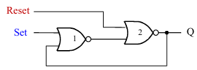
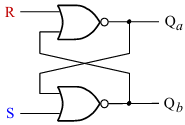
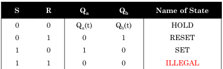
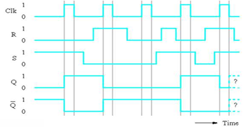
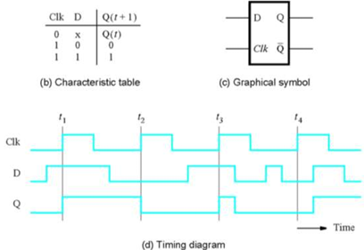
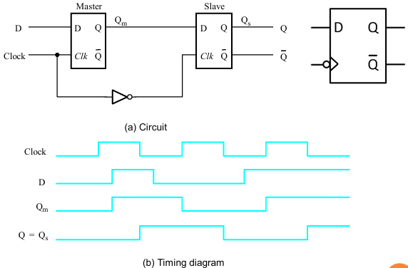
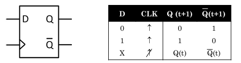
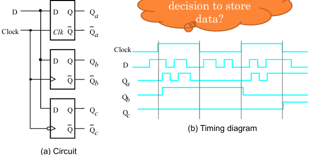

# 数字逻辑设计

## 时序电路

### 定义

输出依赖于当前的输入和当前的状态

### 图表

### characteristic table(特征表)

### timing diagram

### latch

#### SR latch

- `S`表示置位信号,将输出置1,`R`表示复位信号,将输出置0
- 使用NOR时,SR锁存器与Q相连的是R;使用NAND时,与Q相连的是S

#### D latch

- 令 $S = D, R=\bar{D}$ ,避免非法输入
- 当Clk=1时,Q=D;当Clk=0时,Q不变
- 潜在问题 -- `采用边沿触发`
1. D端信号的噪声会直接传递到Q,可能会被误认为有效信号
2. 当D与Clk的下降沿同时发生时,可能导致Q的输出结果不可预测

### flip-flop(触发器)

#### master-slave D flip-flop

- 两个D锁存器采用互补的时间信号,从锁存器的D端与主锁存器的Q端相连
- 当`非`在主D锁存器前时为上升沿触发器,否则为下降沿触发器
- 当处于上升沿/下降沿时,Q与D一致

#### comparison

- 注意: Q的变化会有延迟

#### D flip-flops with clear and preset

- clear: 将Q置0(clear_n表示低电平有效)
- preset: 将Q置1
- asynchronous: 异步,不需要等待时钟边沿就能作用
- synchronous: 同步,需要等待时钟边沿才能作用

### 词汇索引

|关键名词|翻译|
|---|---|
|组合逻辑电路|combinational logic circuits|
|时序逻辑电路|sequential logic circuits|
|异步|asynchronous|
